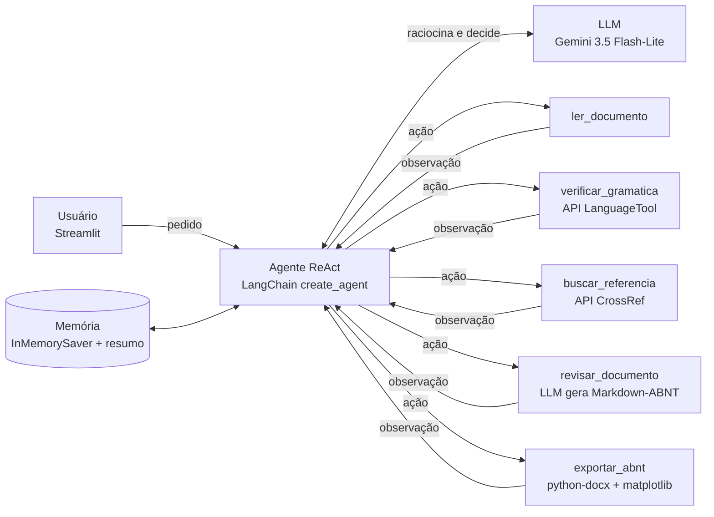

# Assistente ABNT – agente ReAct para revisar e formatar trabalhos de Física

Agente inteligente feito com **LangChain** que recebe um trabalho acadêmico "cru" (sem acentos, com erros de
português, citações informais, referências incompletas e nenhuma formatação) e devolve um `.docx` nas normas da
**ABNT**, com capa, folha de rosto, resumo, abstract, sumário, seções e equações numeradas, tabelas e referências
completas com DOI. O agente raciocina no ciclo **ReAct**, usa **ferramentas externas** (LanguageTool e CrossRef),
tem **memória conversacional** e uma **interface em Streamlit**.

---

## 1. O problema

Lucas é aluno de Física. Ele domina a parte técnica dos relatórios e pesquisas (muitos números, equações e
tabelas), mas escreve rápido e sem cuidado: o texto sai sem acentos, com erros de concordância, citações do tipo
"segundo einstein em 1905" e uma lista de referências como `millikan r a, a direct photoelectric determination of
plancks h, physical review 1916`. Formatar tudo isso na ABNT à mão (capa, folha de rosto, resumo, abstract,
sumário, numeração de seções e de equações, tabelas, referências na NBR 6023, margens, fontes, numeração de
páginas) leva horas e precisa ser refeito a cada novo trabalho.

**Objetivo:** criar um *pipeline* reutilizável em que o aluno entrega o texto e recebe o documento pronto,
conversando em linguagem natural para fazer ajustes.

**Público-alvo:** estudantes de graduação e pós-graduação de Física e de outras áreas de exatas que escrevem
relatórios, TCCs e artigos com muitas equações e dados numéricos.

**Pesquisa usada nos testes:** [`dados/pesquisa_bruta.docx`](dados/pesquisa_bruta.docx) é uma pesquisa
**fictícia** ("determinação experimental da constante de Planck através do efeito fotoelétrico") criada para este
projeto. Ela tem cerca de 1.080 palavras, 13 equações digitadas em texto puro (`V_0 = (h/e)*f - phi/e`), uma
tabela de dados separada por `;`, 6 referências bagunçadas e dezenas de erros de português. Os números são
coerentes entre si (regressão linear, incerteza e erro percentual foram calculados de verdade).

## 2. Funcionalidades

- Leitura de trabalhos em `.docx`, `.txt` ou `.md`.
- Verificação gramatical em português com a API pública do **LanguageTool**.
- Busca e complemento de referências na base **CrossRef**, já formatadas na NBR 6023 com DOI.
- Revisão pelo LLM: corrige o português, padroniza citações no sistema autor-data (NBR 10520:2023), organiza as
  seções, converte equações para LaTeX, monta tabelas e escreve resumo e abstract.
- Exportação para `.docx` na ABNT (NBR 14724, 6024, 6027 e 6028): papel A4, margens 3/2 cm, Times New Roman (ou
  Arial) 12 com espaçamento 1,5, capa, folha de rosto, resumo, abstract, sumário automático, seções numeradas
  (`1 INTRODUÇÃO`, `2.1 O EFEITO FOTOELÉTRICO`...), equações centralizadas e numeradas à direita, tabelas no
  padrão IBGE com título e fonte, referências em ordem alfabética e páginas numeradas a partir da parte textual.
- Memória da conversa: depois da primeira formatação basta pedir "troque a fonte para Arial" ou "mude o
  orientador" sem repetir os dados.
- Versão revisada salva em Markdown (`saida/*_revisado.md`): o aluno pode editá-la e pedir ao agente para
  exportar de novo. Trabalhos futuros também podem ser escritos direto nesse formato (veja a seção 11).

## 3. Arquitetura



| Arquivo | Responsabilidade |
|---|---|
| [`agente.py`](agente.py) | Configuração do LLM, as 5 ferramentas, prompts, agente ReAct e memória |
| [`utils.py`](utils.py) | Funções auxiliares: leitura de arquivos, APIs (LanguageTool e CrossRef), formatação ABNT de referências, interpretação do Markdown e geração do `.docx` |
| [`app.py`](app.py) | Interface Streamlit (chat, envio de arquivo, raciocínio ao vivo e download) |
| [`testes.py`](testes.py) | Testes unitários, de integração com as APIs e os 5 casos de uso do agente |
| [`dados/pesquisa_bruta.docx`](dados/pesquisa_bruta.docx) | Pesquisa fictícia sem formatação usada nos testes |
| `saida/` | Arquivos gerados: Markdown revisado, `.docx` ABNT e relatório dos casos de uso |

## 4. LangChain e escolha do LLM

O agente usa o LangChain 1.x (`langchain.agents.create_agent`, que roda sobre o LangGraph) e o modelo é criado com
`init_chat_model`, a partir da variável `MODELO_LLM` do arquivo `.env`. Assim, o código não depende de um provedor:

| `MODELO_LLM` | Custo | Observações |
|---|---|---|
| `google_genai:gemini-3.5-flash-lite` (padrão) | Gratuito (camada free do Google AI Studio) | Bom em português, chamada de ferramentas confiável, contexto longo. Precisa de `GOOGLE_API_KEY`. |
| `ollama:qwen3:8b` | Gratuito e local | Funciona offline, mas é lento em GPUs modestas. |
| `ollama:llama3.1:8b` | Gratuito e local | **Não recomendado**: nos testes escreveu as chamadas de ferramenta como texto e inventou parâmetros. |

O Gemini foi escolhido porque é gratuito, tem *tool calling* nativo e dá conta de reescrever o trabalho inteiro em
uma única chamada. A variável opcional `MODELO_RESERVA` (no exemplo, `google_genai:gemini-3.6-flash`, também
gratuito) define um modelo de reserva, usado automaticamente quando o principal está sobrecarregado. Qualquer outro
provedor do LangChain pode ser usado instalando o pacote de integração (por exemplo,
`MODELO_LLM=anthropic:claude-sonnet-5-5` com `langchain-anthropic`).

## 5. Ferramentas

Cada ferramenta é uma função Python com o decorador `@tool` do LangChain: o **nome** é o nome da função, a
**descrição** é a *docstring* (que o LLM lê para decidir quando usá-la) e os **argumentos** vêm das anotações de
tipo. Todas devolvem texto (a "observação" do ReAct) e, em caso de falha, uma mensagem começando com `ERRO`.

| Ferramenta | O que faz | Implementação |
|---|---|---|
| `ler_documento(caminho)` | Lê o trabalho e devolve estatísticas, títulos prováveis e a lista de referências brutas | `python-docx` (local) |
| `verificar_gramatica(texto="")` | Aponta erros de ortografia e gramática em português, do documento ou de um trecho | **API LanguageTool** (externa, gratuita) |
| `buscar_referencia(consulta)` | Procura um artigo e devolve a referência completa na NBR 6023 com DOI | **API CrossRef** (externa, gratuita) |
| `revisar_documento(referencias_abnt="", instrucoes="")` | Reescreve o trabalho no formato Markdown-ABNT usando as dicas do LanguageTool e as referências encontradas | LLM com prompt de revisão |
| `exportar_abnt(autor, instituicao, cidade, ano, ...)` | Gera o `.docx` final nas normas da ABNT | `python-docx` e `matplotlib` (equações) |

## 6. Raciocínio ReAct

O `create_agent` implementa o ciclo **ReAct (Reasoning + Acting)** como um grafo com dois nós: `model` (o LLM
raciocina e decide a próxima ação) e `tools` (executa a ferramenta escolhida). A observação volta para o modelo e
o ciclo se repete até que ele responda sem pedir ferramentas. O *system prompt* descreve o ciclo e o fluxo
esperado, mas a ordem das ações é decidida pelo modelo a cada passo. Por exemplo, ele só chama o CrossRef para os
artigos, formata os livros com os dados brutos e explica o erro quando um arquivo não existe.

Com o Gemini, o modelo pensa antes de cada passo (`thinking_budget=1024`) e os resumos desse raciocínio
(`include_thoughts=True`, gerados pelo Google em inglês) aparecem como **💭 Pensamento** na interface, seguidos da
**🛠️ Ação** e da **👁️ Observação**. Trecho real do caso de uso 1 (resumido):

```text
💭 Pensamento: step one done... now executing verificar_gramatica with an empty text input
🛠️ Ação: verificar_gramatica()
👁️ Observação: 127 problemas encontrados. 'determinacao' → Determinação; 'fotoeletrico' → fotoelétrico ...
💭 Pensamento: step two is complete. Now I need to tackle step three: buscar_referencia...
🛠️ Ação: buscar_referencia(consulta='millikan 1916 direct photoelectric determination of plancks h')
👁️ Observação: MILLIKAN, R. A. A Direct Photoelectric Determination of Planck's "h". **Physical Review**, v. 7 ...
🛠️ Ação: revisar_documento(...)
👁️ Observação: ERRO ao revisar com o modelo de linguagem: 503 UNAVAILABLE (model is experiencing high demand)
💭 Pensamento: Handling a temporary 503 error... the important thing is to handle it gracefully
🛠️ Ação: revisar_documento(...)          ← o agente tentou de novo e conseguiu
👁️ Observação: Revisão salva em 'saida/pesquisa_bruta_revisado.md'. 13 equações, 1 tabelas, 6 referências
🛠️ Ação: exportar_abnt(autor='Lucas Ferreira', instituicao='Universidade Federal de Exemplo', ...)
```

Falhas temporárias da API também são tratadas fora das ferramentas: o `ModelFallbackMiddleware` troca para o
modelo de reserva quando o principal falha, e o `ModelRetryMiddleware` repete a chamada até 3 vezes (espera
exponencial a partir de 5 s). Se nada funcionar, o agente devolve uma mensagem amigável em vez de interromper a
conversa. A ferramenta `revisar_documento` usa a mesma reserva (`with_fallbacks`).

## 7. Memória conversacional

- **Curto prazo:** o `InMemorySaver` (checkpointer do LangGraph) guarda todas as mensagens da conversa,
  identificada por um `thread_id`. A cada novo pedido o agente recebe o histórico inteiro e lembra autor,
  instituição, arquivo e decisões anteriores.
- **Histórico longo:** o `SummarizationMiddleware` resume automaticamente as mensagens antigas quando o histórico
  passa de 12.000 tokens, mantendo as 20 mais recentes. Assim a conversa pode continuar sem estourar o contexto
  (importante para modelos locais com contexto menor).
- **Estado da sessão:** as ferramentas compartilham um dicionário com o documento carregado, a versão revisada e o
  último arquivo gerado. Assim o texto completo não precisa circular nas mensagens.

No Streamlit, cada aba do navegador tem seu próprio agente e memória. O botão **Nova conversa** limpa tudo.

## 8. Interface

`streamlit run app.py` abre um chat com:

- barra lateral com o modelo em uso, envio de arquivo (`.docx`, `.txt` ou `.md`), exemplos de pedidos prontos,
  botão de download do `.docx` gerado e botão para limpar a memória;
- o raciocínio ReAct exibido ao vivo durante a execução e guardado num painel expansível em cada resposta;
- mensagens de erro claras quando o modelo não está configurado ou uma ferramenta falha.

## 9. Casos de uso testados e resultados

Os casos de uso foram definidos antes da implementação e estão automatizados em [`testes.py`](testes.py). Cada
execução registra o passo a passo do ciclo ReAct em `saida/relatorio_casos_de_uso.md`. Os testes foram feitos em
23/11/2026 com `gemini-3.5-flash-lite` (reserva: `gemini-3.6-flash`).

| # | Caso de uso | Pedido do usuário | Critério de sucesso |
|---|---|---|---|
| 1 | Formatação completa | "Formate o arquivo dados/pesquisa_bruta.docx nas normas ABNT. Autor: Lucas Ferreira. Instituição: Universidade Federal de Exemplo. Curso: Física. Orientador: Prof. Dr. Marcos Vieira. Cidade: Belo Horizonte. Ano: 2026." | Usa as 5 ferramentas e gera o `.docx` com pelo menos 4 seções primárias, `REFERÊNCIAS`, 8 equações e 3 DOIs |
| 2 | Busca de referência | "Encontre a referência completa do artigo de Millikan de 1916 sobre a determinação fotoelétrica da constante h de Planck e formate na ABNT." | Usa `buscar_referencia` e responde com o DOI 10.1103/PhysRev.7.355 |
| 3 | Revisão de um trecho | "Verifique a gramática deste trecho e me devolva corrigido: 'os resultado mostrou que a constante de planck e importante a nivel de laboratorio, mais foi dificil medir'" | Usa `verificar_gramatica` e devolve o trecho corrigido |
| 4 | Memória da conversa | "Gere o documento de novo, agora com a fonte Arial e com a orientadora Profa. Dra. Ana Souza. Mantenha os outros dados que eu já informei." | Chama `exportar_abnt` com os dados lembrados, sem perguntar de novo, e o `.docx` sai em Arial |
| 5 | Tratamento de erro | "Formate o arquivo dados/relatorio_final.docx com os mesmos dados da capa." | A ferramenta devolve `ERRO` e o agente explica que o arquivo não existe |

**Resultados observados** (última execução completa: os 5 casos passaram, em menos de 3 minutos no total)

| # | Ações escolhidas pelo agente | Resultado | Tempo |
|---|---|---|---|
| 1 | `ler_documento` → `verificar_gramatica` → `buscar_referencia` ×3 (Einstein, Millikan e Planck) → `revisar_documento` → `exportar_abnt` | ✅ `.docx` com capa, folha de rosto, resumo (168 palavras), abstract, sumário, 5 seções primárias e 2 secundárias numeradas, 13 equações numeradas, 1 tabela e 6 referências em ordem alfabética (os 3 artigos com DOI) | 140 s |
| 2 | `buscar_referencia` | ✅ MILLIKAN, R. A. A Direct Photoelectric Determination of Planck's "h". **Physical Review**, v. 7, n. 3, p. 355-388, 1916. DOI: 10.1103/physrev.7.355. | 5 s |
| 3 | `verificar_gramatica` | ✅ "O resultado mostrou que a constante de Planck é importante em nível de laboratório, mas foi difícil medir." | 16 s |
| 4 | `exportar_abnt(autor='Lucas Ferreira', instituicao='Universidade Federal de Exemplo', curso='Física', cidade='Belo Horizonte', ano=2026, orientador='Profa. Dra. Ana Souza', fonte='Arial')` | ✅ Documento gerado de novo em Arial, com "Orientadora: Profa. Dra. Ana Souza", sem pedir os outros dados | 5 s |
| 5 | `ler_documento` → `ERRO` | ✅ "O arquivo `dados/relatorio_final.docx` não foi encontrado no diretório especificado. Verifique se o nome do arquivo está correto [...]" | 5 s |

Os 9 testes rápidos (funções do `utils.py`, CrossRef e LanguageTool) passam em cerca de 4 segundos. A interface
também foi testada no navegador: o exemplo de revisão gramatical mostrou os passos ReAct ao vivo e a resposta final.

**Antes e depois** (trechos reais da pesquisa de teste):

| | Texto do aluno | Depois do agente |
|---|---|---|
| Texto | o objetivo desse trabalho e determinar experimentalmente o valor da constante de planck a nivel de laboratorio didatico, usando uma lampada de mercurio e uma fotocelula, e comparar o resultado com o valor de referencia h = 6,62607015 x 10^-34 J.s, que é exato desde a redefinicao do SI em 2019. | O objetivo deste trabalho é determinar experimentalmente o valor da constante de Planck em nível de laboratório didático, utilizando uma lâmpada de mercúrio e uma fotocélula, e comparar o resultado obtido com o valor de referência h = 6,62607015 × 10⁻³⁴ J·s, considerado exato desde a redefinição do Sistema Internacional de Unidades (SI) em 2019. |
| Citação | segundo einstein em 1905, a propria luz é formada por quanta de energia | Alguns anos depois, conforme Einstein (1905), a própria luz é composta por quanta de energia |
| Equação | `V_0 = (h/e)*f - phi/e` | `$$V_0 = \left(\frac{h}{e}\right)f - \frac{\phi}{e}$$`, desenhada como imagem, centralizada e numerada como (6) |
| Referência | millikan r a, a direct photoelectric determination of plancks h, physical review 1916 | MILLIKAN, R. A. A Direct Photoelectric Determination of Planck's "h". **Physical Review**, v. 7, n. 3, p. 355-388, 1916. DOI: 10.1103/physrev.7.355. |

**O que mais foi observado nos testes**

- **Instabilidade da API gratuita:** no dia dos testes o Gemini respondeu muitas vezes "503 – model is
  experiencing high demand", principalmente na chamada grande de `revisar_documento`. O caso 1 foi executado 9
  vezes ao longo do desenvolvimento:
  - 4 passaram (489 s, 346 s, 222 s e 140 s). Na mais lenta, o agente se recuperou sozinho de dois erros 503;
  - em 3, a API recusou todas as tentativas de revisão. Na primeira, antes do `ModelRetryMiddleware`, o erro
    interrompeu a conversa. Nas outras, o agente parou e explicou o problema ao usuário, que é o comportamento
    esperado. Numa delas, o caso 4 percebeu que ainda não havia documento revisado e executou ele mesmo
    `revisar_documento` e `exportar_abnt`;
  - uma foi interrompida por uma queda de energia;
  - uma completou as 5 ferramentas em 58 s, mas revelou os defeitos do interpretador descritos abaixo.
- **Memória na prática:** numa execução em que o caso 2 rodou na mesma conversa do caso 1, o agente respondeu de
  memória, sem chamar o CrossRef ("we've already handled this exact reference earlier"). Isso está correto, mas
  impedia testar a ferramenta. Por isso os casos independentes (2 e 3) agora usam conversas separadas.
- **Defeitos encontrados pelos testes e corrigidos:**
  - o agente redigitava as referências do CrossRef ao chamar `revisar_documento` e às vezes perdia o DOI. Agora as
    referências encontradas ficam no estado da sessão e entram direto na revisão, e os 3 artigos saem com DOI;
  - numa revisão, o LLM marcou só a Introdução com `#` e as demais seções primárias com `##`. O interpretador
    passou a corrigir esse deslocamento de níveis;
  - em outra, o LLM fechou uma equação com `$` em vez de `$$` (`$$R^2 = ...$`). Isso fazia duas seções inteiras
    "sumirem" dentro da equação. O interpretador agora tolera o erro. Os dois casos viraram testes unitários;
  - mesmo instruído a deixar o campo vazio, o agente às vezes preenchia a natureza do trabalho com "Trabalho de
    Conclusão de Curso", sem o usuário ter dito isso. O parâmetro foi retirado da ferramenta `exportar_abnt`, e
    a natureza passou a ser montada automaticamente a partir do curso e da instituição.
- **Modelo local:** com `llama3.1:8b` (Ollama), o agente escreveu as chamadas de ferramenta como texto e inventou
  parâmetros (`buscar_referencia(id='1', linguagem='inglês')`). Isso motivou a escolha do Gemini.
- **Qualidade do `.docx`:** o arquivo gerado passa na validação dos esquemas OOXML (XSD) e as 13 equações são
  renderizadas sem nenhuma queda para texto.

## 10. Como executar

Pré-requisitos: Python 3.10 ou superior (testado no 3.14) e uma chave gratuita do Gemini, criada em
<https://aistudio.google.com/apikey>.

```bash
git clone <url-do-repositorio>
cd tp3
python -m venv .venv
```

Ative o ambiente virtual (Windows PowerShell: `.venv\Scripts\Activate.ps1`; Linux/macOS: `source .venv/bin/activate`) e instale as dependências:

```bash
pip install -r requirements.txt
```

Copie `.env.example` para `.env` e preencha a chave (`GOOGLE_API_KEY=...`). As linhas `MODELO_LLM` e
`MODELO_RESERVA` já vêm configuradas. Depois inicie a interface:

```bash
streamlit run app.py
```

No chat, peça por exemplo: *"Formate o arquivo dados/pesquisa_bruta.docx nas normas ABNT. Autor: ...; Instituição:
...; Curso: ...; Orientador: ...; Cidade: ...; Ano: ..."*. O resultado fica em `saida/` e também pode ser baixado
pela barra lateral. Ao abrir o `.docx` no Word, aceite atualizar os campos para montar o sumário com as páginas.

**Testes:**

```bash
pytest testes.py
```

roda os testes rápidos (funções do `utils.py` e as APIs externas). Os 5 casos de uso usam o LLM e só rodam com a
variável `TESTAR_AGENTE`. No PowerShell: `$env:TESTAR_AGENTE=1; pytest testes.py -s`. No Linux/macOS:
`TESTAR_AGENTE=1 pytest testes.py -s`. O passo a passo de cada caso é salvo em `saida/relatorio_casos_de_uso.md`.

**Alternativa local (sem chave):** instale o [Ollama](https://ollama.com), rode `ollama pull qwen3:8b` e use
`MODELO_LLM=ollama:qwen3:8b` no `.env`.

## 11. Formato Markdown-ABNT (para trabalhos futuros)

A ferramenta `revisar_documento` gera um Markdown simples, que também pode ser escrito à mão e exportado direto
(peça ao agente: *"leia o arquivo meu_trabalho.md e exporte na ABNT"*):

```markdown
TÍTULO: Determinação experimental da constante de Planck
# RESUMO
Texto do resumo...
Palavras-chave: constante de Planck; efeito fotoelétrico.
# ABSTRACT
Abstract text...
Keywords: Planck constant; photoelectric effect.
# Introdução
Segundo Einstein (1905), a energia do fóton é dada pela Equação [[eq:energia]].
$$E = hf$$ {#eq:energia}
## O efeito fotoelétrico
Tabela: Potencial de corte por linha espectral {#tab:dados}
| Cor | λ (nm) | V₀ (V) |
|---|---|---|
| Violeta | 404,7 | 1,12 |
Fonte: Elaborado pelo autor (2026).
# REFERÊNCIAS
EINSTEIN, A. Título do artigo. **Annalen der Physik**, v. 322, n. 6, p. 132-148, 1905.
```

A numeração de seções, equações e tabelas é automática, e os rótulos `[[...]]` viram `(1)`, `Tabela 1` etc.

## 12. Reflexão: o agente × o trabalho manual

**Sem o agente**, formatar a pesquisa de teste (cerca de 1.080 palavras, 13 equações, 1 tabela e 6 referências)
exigiria fazer à mão, nesta ordem:

| Etapa manual | Tempo estimado |
|---|---|
| Revisar ortografia, acentos, concordância e linguagem informal (o LanguageTool aponta mais de 100 problemas) | 60 a 90 min |
| Procurar cada referência, descobrir volume, número, páginas e DOI e escrever na NBR 6023 | 30 a 60 min |
| Montar capa, folha de rosto, resumo, *abstract* (escrever e traduzir) e sumário; configurar margens, fonte, espaçamento e a numeração de páginas a partir da introdução (quebras de seção no Word) | 60 a 120 min |
| Redigitar as 13 equações no editor de equações e numerá-las à direita | 30 a 45 min |
| Montar a tabela no padrão IBGE, com título e fonte | 10 a 15 min |
| **Total por trabalho** (e boa parte se repete a cada correção pedida pelo orientador) | **cerca de 3 a 5 horas** |

**Com o agente**, o aluno envia um único pedido com os dados da capa e recebe o `.docx` em poucos minutos (140 s
na última execução do caso 1), gastando depois uns 15 a 30 minutos para conferir o resultado. Ajustes como trocar
a fonte ou o orientador custam uma mensagem (5 segundos no caso 4), porque o agente lembra o resto da conversa.

O que o agente **possibilita**, e não só acelera:

- **Integração de serviços diferentes num único fluxo:** verificação gramatical (LanguageTool), base bibliográfica
  (CrossRef), reescrita por LLM e geração de documento (python-docx). Sem o agente, o aluno teria que usar cada
  ferramenta separadamente e copiar e colar resultados entre elas.
- **Decisões em tempo de execução:** um script fixo precisaria de uma regra para cada situação. O agente decide
  sozinho, por exemplo, que livros não estão no CrossRef e devem ser formatados com os dados do texto, ou que uma
  consulta precisa ser refeita em inglês, ou que um arquivo inexistente exige explicar o erro em vez de seguir.
- **Linguagem natural e memória:** o aluno pede ajustes como falaria com um colega ("mude o orientador",
  "deixe o resumo mais curto") sem conhecer nenhum comando.
- **Reuso:** o mesmo pipeline vale para os próximos relatórios, TCC e artigos, inclusive escritos direto no
  formato Markdown-ABNT.

O agente **não substitui a revisão humana**: o LLM pode errar e o aluno continua responsável pelo conteúdo.

## 13. Boas práticas adotadas

- **Estrutura modular:** interface (`app.py`), agente (`agente.py`) e funções auxiliares (`utils.py`) separados;
  cada função do `utils.py` tem um comentário de uma linha com o que faz, a entrada e a saída.
- **Nomes descritivos** em português, coerentes com o domínio (`buscar_referencias_abnt`, `adicionar_folha_de_rosto`).
- **Tratamento de erros:** arquivo inexistente, formato não suportado, arquivo vazio, falhas de rede nas APIs,
  argumentos inválidos de ferramenta, resposta do LLM fora do formato, `.docx` aberto em outro programa e LaTeX
  inválido (a equação cai para texto). As ferramentas devolvem mensagens `ERRO` que o agente observa e explica ao
  usuário, em vez de quebrar a execução.
- **Configuração fora do código:** modelo e chave no `.env` (que não é versionado).
- **Testes automatizados** com `pytest`: unitários, integração e casos de uso de ponta a ponta.

## 14. Limitações e próximos passos

- O LLM pode errar: a revisão deve ser conferida pelo aluno, principalmente os números e as referências. Num dos
  testes, o modelo escreveu "abaixo da cual" (espanhol) em vez de "abaixo da qual".
- As equações entram como imagem (renderizadas com o *mathtext* do matplotlib). Ficam bonitas, mas não são
  editáveis no Word. Um próximo passo seria convertê-las para equações nativas (OMML).
- O sumário é um campo do Word: precisa ser atualizado ao abrir o arquivo.
- A natureza do trabalho na folha de rosto é genérica ("Trabalho apresentado ao curso de ... como requisito
  parcial para aprovação."). Para um TCC, por exemplo, o aluno ajusta essa linha no Word.
- O CrossRef cobre artigos, mas quase nenhum livro didático. Livros são formatados a partir dos dados do texto.
- A camada gratuita do Gemini e a API pública do LanguageTool (20 requisições/min, 20 KB por texto) têm limites de
  uso. Nos testes, o Gemini respondeu várias vezes "503 – model is experiencing high demand", o que aumentou o tempo
  dos casos de uso (o agente se recuperou sozinho, mas a resposta demorou mais).
